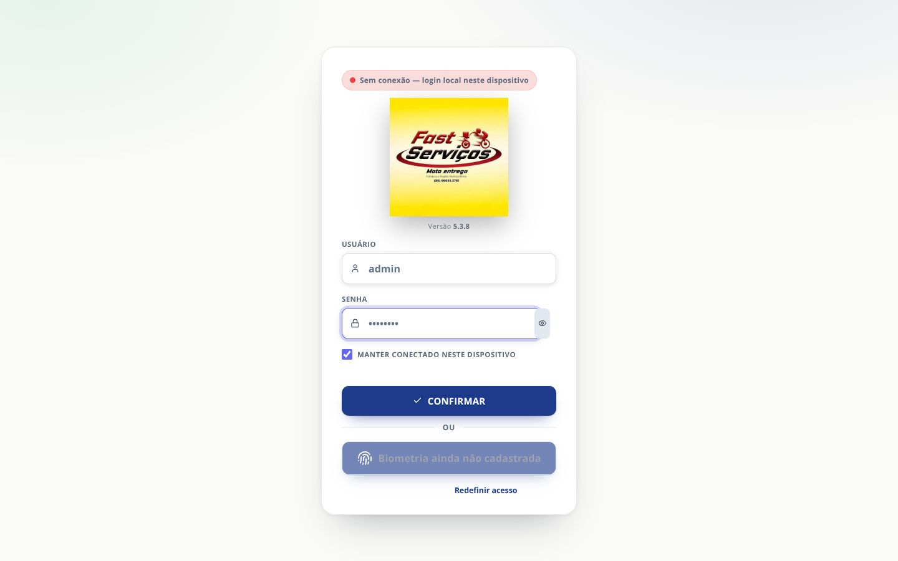
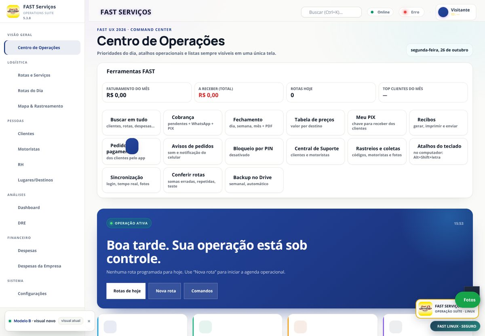
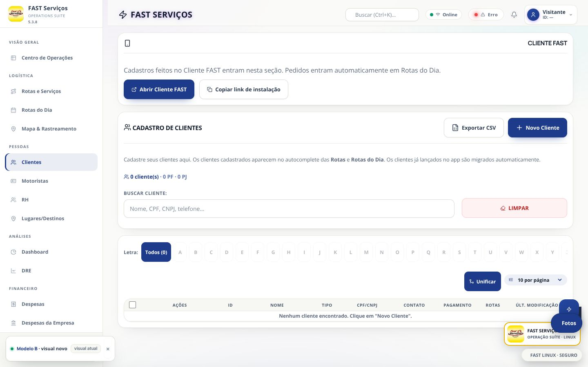
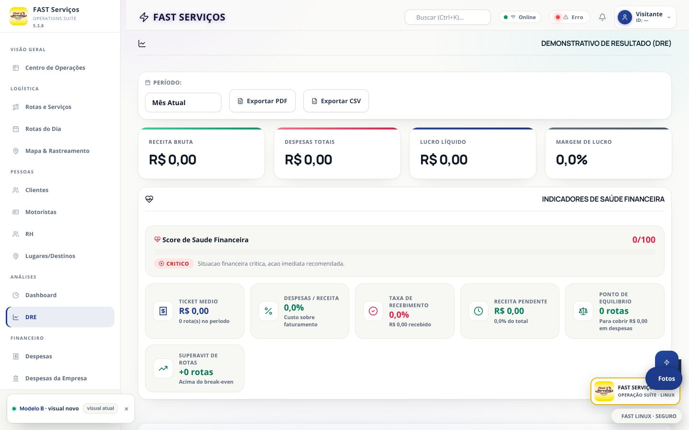
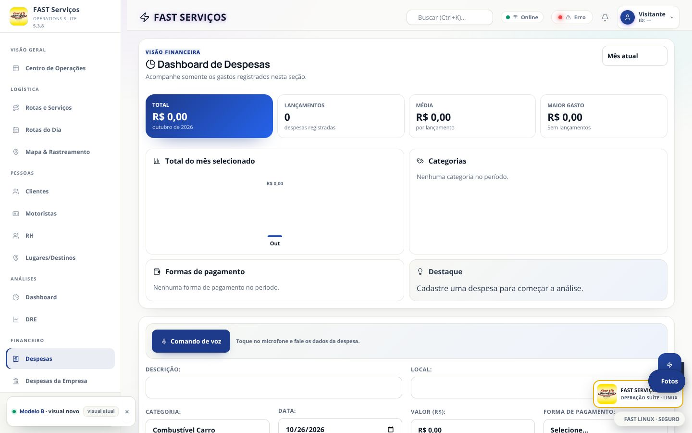
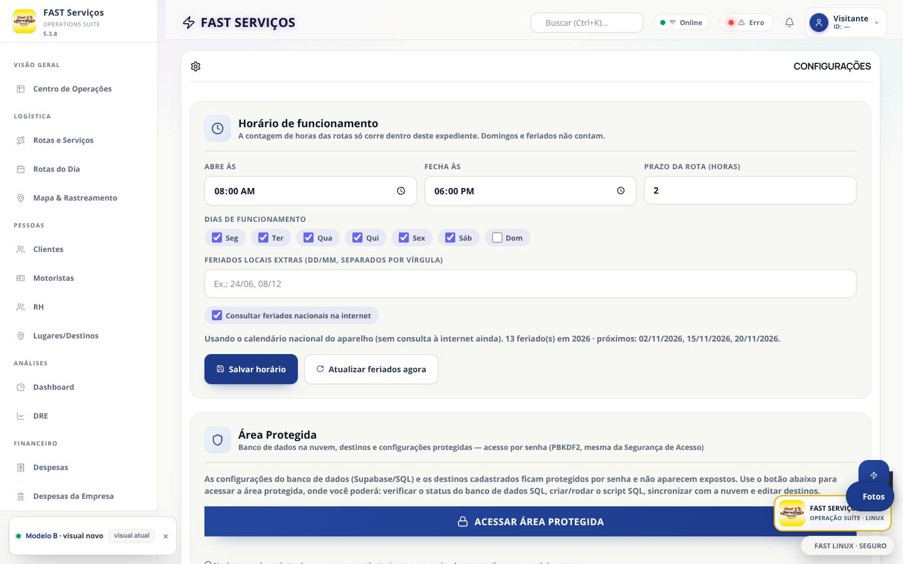
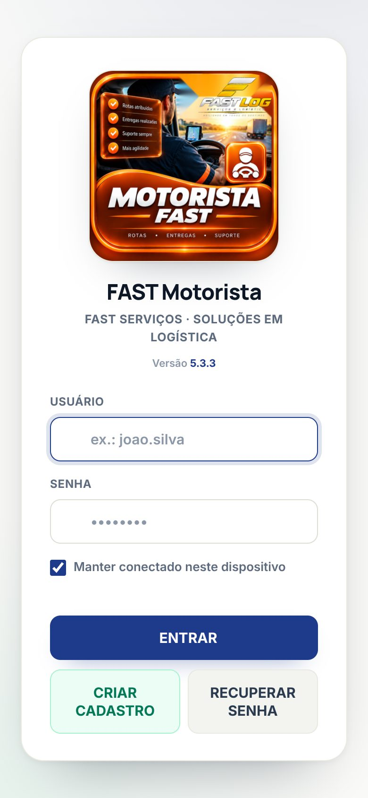

# Modelo B — o FAST com o visual novo

Esta pasta é o **app inteiro** (mesmas telas, mesmas funções, mesma
sincronização, mesmos apps) com a pele do Modelo B. Ela é **gerada** a partir
do app que já está no ar: nenhum arquivo do app atual foi alterado.

| | |
|---|---|
| App atual (intocado) | [`/`](../index.html) |
| Modelo B | [`/modelo-b/`](index.html) |
| Apps do Modelo B | [`app-motorista`](app-motorista/index.html) · [`app-cliente`](app-cliente/index.html) · [`app-rotas-dia`](app-rotas-dia/index.html) · [`app-despesas`](app-despesas/index.html) · [`app-limpo`](app-limpo/index.html) |
| Paridade verificada | [`PARIDADE.md`](PARIDADE.md) |
| Testes de sincronização, layout e transições | [`TESTES.md`](TESTES.md) |

No navegador, o botão **“Modelo B · visual novo”** (canto inferior esquerdo)
volta para o visual atual naquele aparelho; a escolha fica em
`localStorage.fast_modelo_b` e não toca em nenhum dado do app.

## Como funciona (não é uma cópia do app)

`build.py` copia cada `index.html` real e injeta, **antes de `</head>`**:

```html
<base href="../">                            <!-- apps: ../../<app>/ -->
<link rel="stylesheet" href="modelo-b/skin-modelo-b.css">
<script src="modelo-b/lucide.js" defer></script>
<script src="modelo-b/skin.js" defer></script>
<!-- nos apps: skin-apps.css + skin-apps.js -->
```

O `<base>` mantém **todos** os caminhos originais (scripts, `assets`, fontes,
`fast-sw.js`, manifest e pastas dos apps) apontando para os arquivos reais na
raiz. Como o motor é o mesmo arquivo, a sincronização é a mesma.

O build confere, a cada execução:

1. o HTML gerado, **removida a injeção**, é idêntico byte a byte ao original;
2. a lista de scripts do app não muda (só entram `lucide.js`/`skin.js`, e
   `skin-apps.js` nos apps);
3. a URL do service worker não muda;
4. os arquivos da skin existem.

```bash
python3 modelo-b/build.py           # gera/atualiza as 6 páginas
python3 modelo-b/build.py --check   # só confere (sai com erro se estiver velho)
```

`build-info.json` guarda o SHA-256 (12 primeiros caracteres) da origem de cada
página. As cópias são descartáveis: **edite o app real** (ou a skin) e rode o
build de novo.

## Recuperar lugares (socorro)

`recuperar-lugares.html` — página avulsa, na mesma origem do app, que lê **todas** as
cópias locais do banco (localStorage, `fastapp_last_known_good`, IndexedDB `state` e os
12 snapshots, `fast_destinos_backup_pre_dedup_v201`) e mostra o que existe em cada uma.

- Diagnostica por que cada lugar sumiu (lista de exclusão, nome começando com número,
  restou só em cópia antiga).
- Restaura os lugares escolhidos gravando `zz liberado <hora> <nome>` no banco **e** no
  cofre `fastapp_exclusoes_permanentes_v1` (senão o app reinsere a exclusão a cada save).
- Grava as 4 cópias com carimbo 1 s à frente para vencer a corrida de abertura.
- Baixa um JSON de segurança antes de qualquer gravação e aceita backup `.json` externo.

Testes (Chromium headless, 2026-10-26): restauração de 3 lugares + liberação de 1 escondido
→ app abriu com 5 lugares, 5 linhas na tabela, 0 erros; estado vazio → mensagem correta,
0 erros; largura 390 px sem rolagem horizontal.


## O que mudou nesta fase (Fase 2)

### Identidade

- off-white `#FAFAF8`, cartões brancos, azul-marinho `#1E3A8A` como cor
  principal e esmeralda `#059669` como acento;
- raio 14–20 px, sombras difusas, tipografia Manrope (títulos) + Inter (texto),
  ambas servidas de `fontes/` (sem depender de CDN);
- **205 classes Font Awesome trocadas por 177 ícones Lucide** (traço, 42 KB),
  mantendo a classe original no `<i>`: se um ícone não tem equivalente, o Font
  Awesome continua. Ícones de marca (WhatsApp, Google, GitHub) ficam como estão.

### Telas do app principal

- login: cartão branco, botão CONFIRMAR marinho, biometria em azul claro;
- menu lateral branco com item ativo marinho e barra de 3 px;
- cabeçalho claro translúcido, busca e pílulas de estado;
- hero da Central em gradiente marinho, com KPIs e tarja de operação;
- tabelas com cabeçalho legível (`#4A586B` sobre `#F3F4EF`);
- cartões de KPI, DRE, Despesas, Configurações e indicadores sem violeta/ciano;
- painel de sincronização em marinho (o vermelho continua nos textos de erro);
- paleta de comandos (Ctrl+K) como folha branca;
- botão flutuante da Central Rápida no canto inferior direito e em marinho,
  respeitando a posição quando a pessoa arrasta;
- botões `.btn-danger` separados por texto: “Limpar/Parar” = contorno vermelho;
  “Salvar/Confirmar” = marinho.

### Apps

- `app-motorista`: acesso claro (era escuro), botões marinho, cabeçalho e ações
  internas em marinho;
- `app-cliente`: fundo off-white, botão Entrar marinho, ícone real no lugar do
  quadrado emoji, cabeçalho marinho;
- `app-rotas-dia`, `app-despesas`, `app-limpo`: páginas de instalação claras,
  botões marinho;
- nos apps, um script pequeno (`skin-apps.js`) aponta as imagens que não
  existiam em `assets/` para os arquivos reais (logo do motorista, ícones dos
  atalhos) e ajusta a cor da barra do navegador.

Nenhuma função, texto, permissão ou chamada ao Supabase foi alterada.

## Arquivos

| Arquivo | Para que serve |
|---|---|
| `build.py` | gera as cópias e verifica a paridade |
| `skin-modelo-b.css` | a pele do app principal (tokens, componentes, seções 1–16) |
| `skin.js` | liga a pele, troca os ícones e reconcilia a pintura a cada troca de tela |
| `lucide.js` | 177 ícones Lucide (42 KB) + 205 mapeamentos `fa-*` → Lucide |
| `lucide-LICENSE.txt` | licença ISC do Lucide |
| `skin-apps.css` / `skin-apps.js` | pele e ajustes visuais dos 5 apps |
| `fontes/` | Inter 400/500/600/700 e Manrope 600/700/800 (woff2) |
| `index.html`, `app-*/index.html` | **gerados** — não editar à mão |
| `build-info.json` | **gerado** — SHA das origens e tamanho das cópias |
| `prints/` | capturas de 26/10/2026: login, 9 abas, celular e os 5 apps |
| `TESTES.md` | resultados dos testes de sincronização, estouro de tela e transições |

## Capturas

| | |
|---|---|
|  |  |
|  |  |
|  |  |
|  |  |

As demais estão em [`prints/`](prints/): Rotas, Rotas do Dia, Motoristas,
Dashboard, login no celular, App Cliente, Rotas do Dia, Despesas e FAST Limpo.

## O que **não** mudou

- `index.html`, `app-*/`, `*.js`, `*.css`, `assets/`, `fast-sw.js` e
  `updates.json` da raiz estão exatamente como estavam (`git status` só mostra
  `modelo-b/`);
- Supabase, tempo real, fila offline (IndexedDB), sessão, Google Drive e
  backups: mesmas URLs e mesmo código;
- versão do app (`5.3.8`), textos, permissões e fluxos.

## Limites conhecidos

- os ícones sem equivalente Lucide continuam em Font Awesome (nenhum some);
- as telas internas de `app-motorista` que já eram escuras seguem escuras — só
  cabeçalho, botões de ação e tipografia mudaram;
- em `file://` (sem internet) o painel de sincronização aparece porque não há
  sessão; ele fica marinho e limitado a 78% da altura;
- a paleta do celular e alguns widgets flutuantes têm posição definida pelo
  app (não pela skin); são os mesmos no visual atual;
- o formato de hora dos campos nativos (`08:00 AM`) segue o idioma do aparelho
  — em português mostra 24 h.

## Testes (26/10/2026)

Os 8 cenários de sincronização (criar online, criar offline e reconectar, duas
abas, recusa do servidor, recuperação, edição offline, receber de outro
aparelho) passaram sem duplicar nada — ver [`TESTES.md`](TESTES.md).
Layout: 13 abas × 6 larguras sem estouro horizontal e sem erro; transições de
aba em 8–32 ms, iguais ao app atual.

## Próxima fase (Fase 3)

1. repetir os testes em dois aparelhos reais (tempo real por WebSocket, modo
   avião de verdade, atualização do service worker após publicar);
2. revisar no Android e no iPhone os apps e o login;
3. decidir se o visual atual é aposentado, promovendo o `modelo-b/` para a
   raiz (o build já garante que é o mesmo app).
